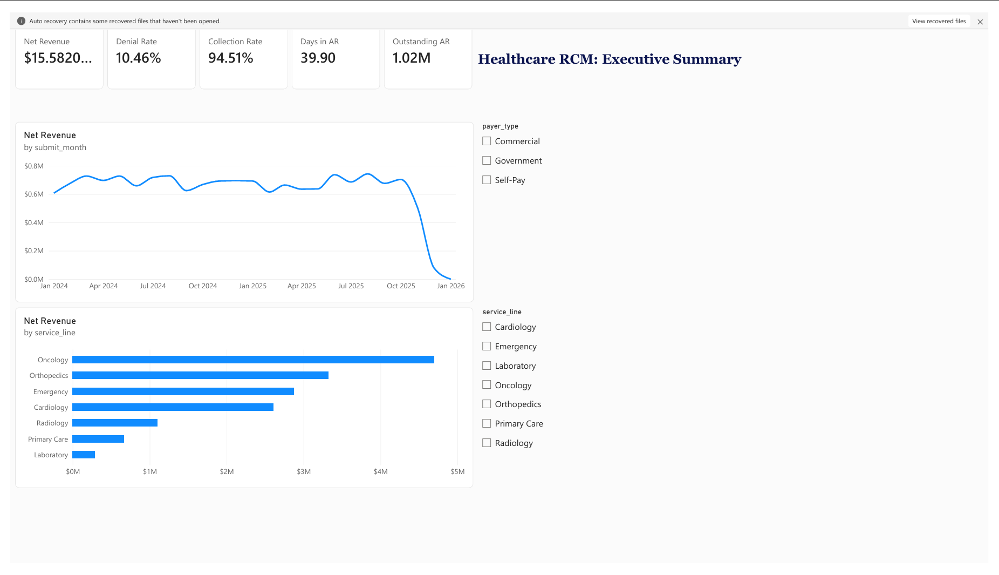
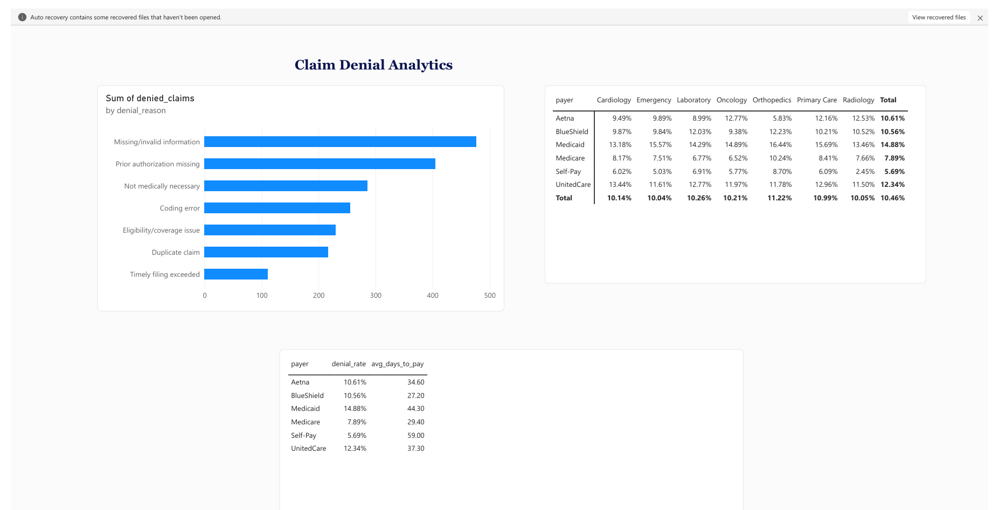
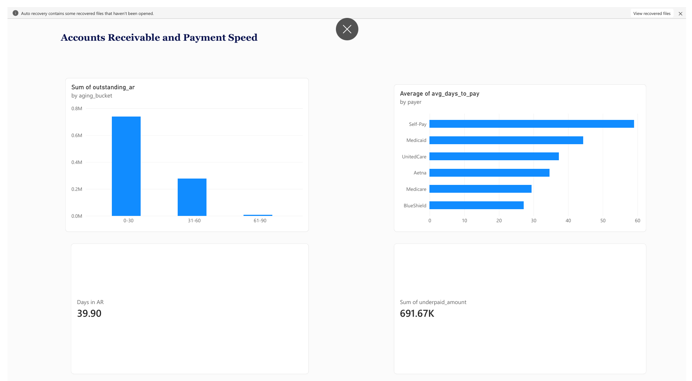
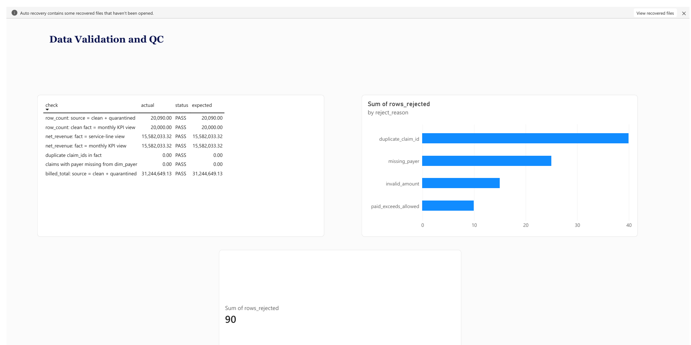

# Healthcare RCM Analytics Dashboard

End-to-end revenue cycle analytics project: synthetic claims data -> Python ingestion, validation and QC ->
SQL reporting layer -> Excel executive summary -> Power BI dashboard.

All data is **synthetic** (no real patient information). Patient IDs are replaced with a salted SHA-256
hash before anything reaches the reporting layer, to mirror HIPAA-aware handling.

## Dashboard preview












## Architecture

```
generate_data.py --> data/raw/billing_claims.csv  (source billing extract, with injected errors)
                          |
pipeline.py:  extract (with retries) -> validate -> quarantine bad rows -> de-identify
                          -> load SQLite (fact_claims, dim_payer) -> build SQL views
                          -> reconcile source vs reporting (QC log) -> export CSVs
                          |
        data/rcm.db  +  data/powerbi/*.csv  +  excel_report.py -> RCM_Executive_Summary.xlsx
                          |
                    Power BI dashboard (see POWERBI_GUIDE.md)
```

## Setup (Windows, PowerShell)

```powershell
python -m venv .venv
.venv\Scripts\Activate.ps1
pip install -r requirements.txt

python generate_data.py     # creates data/raw/*.csv
python pipeline.py          # loads, validates, reconciles, exports
python excel_report.py      # builds the Excel executive summary
```

## KPI definitions

| KPI | Definition |
|---|---|
| Net revenue | Cash collected (`paid_amount`) |
| Denial rate | Denied claims / adjudicated claims (excludes Pending) |
| Collection rate | Paid / allowed on Paid and Partially Paid claims |
| Outstanding AR | Allowed amount of Pending claims |
| Days in AR | Outstanding AR / (allowed charges of last 90 days / 90) |
| Underpaid amount | Allowed - paid on Partially Paid claims (tracked separately from AR) |

## Validation and QC

Rules applied in `pipeline.py` (rejected rows go to `quarantine_claims` with a reason):
duplicate claim ID, missing payer, negative or null amounts, paid > allowed, invalid dates.

Reconciliation checks written to the `qc_log` table on every run:
source rows = clean + quarantined, source billed total = clean + quarantined, fact vs each reporting view
(row counts and net revenue), orphan payers, duplicate IDs. The pipeline exits with code 1 if any check fails.

```sql
SELECT * FROM qc_log ORDER BY run_at DESC;
SELECT reject_reason, COUNT(*) FROM quarantine_claims GROUP BY reject_reason;
```

## Daily refresh (automation)

The pipeline is idempotent, so re-running it also repairs a failed or partial load.
Schedule it with Windows Task Scheduler (run once in an elevated PowerShell):

```powershell
schtasks /Create /SC DAILY /ST 06:00 /TN "RCM Daily Refresh" /TR "C:\path\to\.venv\Scripts\python.exe C:\path\to\rcm_project\pipeline.py"
```

Set a real salt so patient hashes are not guessable: `setx RCM_SALT "a-long-random-string"`.
Logs are written to `logs/pipeline.log`.

## SQL Server version (to match the resume)

The SQL in `sql/views.sql` is SQLite. To run it on SQL Server Express:
1. Load `billing_claims.csv` with `pandas.to_sql` through `sqlalchemy` + `pyodbc`, or the SSMS Import Wizard.
2. Change `strftime('%Y-%m', x)` to `FORMAT(x, 'yyyy-MM')`, `julianday(a) - julianday(b)` to `DATEDIFF(day, b, a)`,
   `date(x, '-90 days')` to `DATEADD(day, -90, x)`, and `CREATE VIEW` after `DROP VIEW IF EXISTS` to `CREATE OR ALTER VIEW`.
3. Window functions (`LAG`, `RANK`, `SUM() OVER`) work unchanged.

## Resume-ready bullets (accurate to what this repo does)

- Built an RCM analytics pipeline over 20K synthetic claims tracking denial rate, days in AR, collection rate and net revenue by service line and payer.
- Wrote SQL views using joins, CTEs and window functions (LAG, RANK, rolling averages) as the reporting layer for Power BI.
- Implemented automated validation and source-to-reporting reconciliation (7 checks per run, quarantine table, QC log) that caught 90 injected errors.
- Automated daily ingestion and refresh in Python with retries, logging and salted-hash de-identification of patient IDs.
- Produced an Excel executive summary with pivot tables and formula-driven KPI status.
